<div align="center">



<br/><br/>

### Principal Systems Architect & Technical Founder · Production Applications · Distributed Systems · Heavy-Context AI

**Systems. Intelligence. Product. Business.**

Building and deploying across distributed systems, AI infrastructure, compilers and runtimes, concurrency, low-latency software, agentic systems, and production engineering.

**AI-accelerated execution. Human-directed judgment.**

<br/>

<a href="https://www.patrickribbsaeter.com/">
  
</a>
&nbsp;&nbsp;
<a href="https://www.ribbsaetersystems.com/">
  
</a>
&nbsp;&nbsp;
<a href="https://www.linkedin.com/in/patrickribbsaeter">
  
</a>

</div>

---

## Operating profile

A cross-disciplinary founder, principal consultant, and systems engineer operating at the intersection of **systems engineering, AI, product, and business**.

Strong in unfamiliar systems: tracing execution behavior to the actual failure mode, identifying the architectural invariant, directing heavy-context AI orchestration and automation, validating edge cases, and shipping the smallest durable correction with deterministic regression coverage.

AI functions as part of the engineering system — accelerating research, codebase exploration, implementation, testing, orchestration, and deployment while keeping architecture, tradeoffs, review interpretation, and final decisions human-directed.

The commercial foundation spans technology, computer retail, fashion, e-commerce, websites, media, marketing, branding, sales, and digital products. Engineering is approached from an operator's perspective: software as infrastructure for building, operating, automating, and scaling real businesses.

**Industry is not the constraint.** The same systems and AI capabilities apply across technology, financial services and banking, healthcare, real estate, retail, commerce, media, and other complex operating environments.

### Hardware engineering & diagnostics background (Prior Venture · 2016–2022)

Founded and operated physical commercial computer retail and component-level hardware diagnostics laboratories across **3 locations in Sweden** (*Laga Dator Umeå*), leading technical staff and servicing thousands of consumer and enterprise machines ([**Full Hardware Lab Archive →**](https://www.patrickribbsaeter.com/hardware) · [**YouTube `@lagadatorumea4210`**](https://www.youtube.com/@lagadatorumea4210) · [**Instagram `@lagadatorumea`**](https://www.instagram.com/lagadatorumea/)):

* **Motherboard Schematics, Electronics, Voltages & Power-Line Functions**: Complete native mastery of multi-layer motherboard schematics, OpenBoardView CAD layouts, and component-level electronics — tracing input/output pinouts (`VIN`/`VOUT`/`EN`/`FB`/`PGOOD`), multi-phase buck regulation (`VCORE`, `PPBUS_G3H`, standby `3.3V_S5`/`5V_S5`, `1.2V`/`1.8V` rails), switching MOSFETs, current-sense amplifiers, high-frequency clock crystals (`32.768 kHz` RTC to `100 MHz` PCIe PLLs), and serial data buses (`I²C`/`SMBus`/`SPI`/`UART`).
* **SMD, High-Density BGA & VRAM Rework**: Trinocular stereomicroscope SMD micro-soldering (`0201`/`0402`/QFN), high-density BGA and **GDDR VRAM memory array** desoldering/reballing over PACE ST 400 infrared bottom preheaters, 0.02mm enameled copper trace jumping, and ultrasonic PCB restoration across Apple MacBooks, GPUs, PCs, smartphones, consoles, and LCD/LED driver boards.
* **EEPROM, SPI Flash, VBIOS & JTAG Programming**: Direct hardware socket flashing of SOIC-8 SPI EEPROM chips (Winbond EFI/BIOS firmware recovery), GPU VBIOS ROM programming, Lattice USB JTAG in-system logic programming (`TCK`/`TMS`/`TDI`/`TDO`), digital storage oscilloscope & 16-channel logic analyzer waveform probing, and FLIR thermal short-circuit isolation.
* **Forensic Hardware Data Recovery**: Full-spectrum hardware write-blocked bitstream cloning, identical donor PCB swaps with SPI ROM chip transfers, bad-sector magnetic platter carving, and direct **TSOP48 / BGA152 raw NAND flash chip dumps** across mechanically degraded HDDs, bricked NVMe/SATA SSDs, and monolithic USB flash media.
* **Custom Compute Rigs, Rackmount Servers & Micro-Soldering Academy**: Engineered multi-GPU dual-loop liquid-cooled workstations (`1600W+` Titanium power delivery, PCIe lane bifurcation) and 1U–4U rackmount servers; and founded a **Micro-Soldering Academy** training other repair business owners and commercial technicians in schematic diagnostics and microscope rework.

`MOTHERBOARD SCHEMATICS` `VOLTAGES & POWER LINES` `SMD · BGA · VRAM REWORK` `EEPROM · SPI · JTAG` `FORENSIC DATA RECOVERY` `CUSTOM COMPUTE RIGS` `MICRO-SOLDERING ACADEMY` `3 LAB LOCATIONS (2016–2022)`

---

## What gets built

### Systems engineering

Distributed systems, backend architecture, concurrency, memory ownership, low-latency runtimes, compiler/runtime behavior, performance, reliability, and production debugging.

`DISTRIBUTED SYSTEMS` `RUNTIMES` `COMPILERS` `CONCURRENCY` `PERFORMANCE`

### Consumer mobile apps & web platforms

Native iOS (Swift), Android (Kotlin), cross-platform React Native and Flutter mobile applications, and high-performance, resilient Next.js/React web platforms. Built for fluid gesture fidelity, offline-first reliability, sub-100ms response, and conversion-optimized commercial execution across banking, healthcare, retail, real estate, and B2B SaaS.

`MOBILE APPS (iOS/ANDROID)` `REACT NATIVE` `FLUTTER` `NEXT.JS` `WEB PLATFORMS` `CROSS-INDUSTRY`

### Agentic systems

Production AI agents, tool-using workflows, orchestration, MCP integrations, model/API integration, human-directed execution, evaluation, retrieval, and automation.

`AGENTS` `MCP` `ORCHESTRATION` `AUTOMATION` `TOOL USE`

### Product systems

Architecture, APIs, SaaS products, internal platforms, deployment, observability, analytics, billing, and operational workflows — including **ZeroSlop™ by Ribbsaeter Systems**, the sovereign pre-flight pull request invariant airlock featuring a **12-Shield Deterministic CWE Security Engine** (`CWE-89`, `CWE-798`, `CWE-639` IDOR, `CWE-78`/`CWE-94`, `CWE-502`, `CWE-918`, `CWE-426` CI Pwn Requests, `CWE-829` AI Slopsquatting, `CWE-400`, and `CVE-2021-42574` Trojan Source / Adversarial Prompt-Injection Immunity), **Single In-Place PR Verdict Card**, and **Zero-Click Cross-Layer Blast Radius** directly inside GitHub Actions without external SaaS dashboard bloat ([**Enterprise Zero-Retention Security Brief →**](https://www.ribbsaetersystems.com/zeroslop/security)).

* **Universal 3-Tier Ecosystem Coverage**: Battle-tested across the hardest systems on Earth—**Tier 1** hyperscale runtimes & compilers (AWS Firecracker, LLVM, PyTorch, ClickHouse, Apache DataFusion, Tokio, Bun), **Tier 2** production cloud platforms & frameworks (Vercel Next.js, Cloudflare Workers, Supabase, web3.py, ArcticDB, Anthropic MCP SDK), and **Tier 3** specialized developer toolkits (Meta TorchTune, Ledger Ragger, Coinbase SDK).
* **High-Impact for Every Engineering Grade**:
  * **Junior & Mid-Level Engineers**: Operates as a senior staff guardian angel—catching contract breaks, hidden regressions, and formatting discrepancies before anyone reviews the pull request, guaranteeing 10/10 green-first confidence on push #1.
  * **Senior Staff & Tech Leads**: Reclaims 60+ hours per sprint by eliminating AI boilerplate review churn and stopping human linter fatigue.
  * **Enterprise Infrastructure & VPs of Engineering**: Mathematically guarantees deterministic invariant integrity, zero unauthorized test deletions, and a 50%–70% reduction in wasted CI runner compute spend.


<br/>

<div align="center">
  <a href="https://www.ribbsaetersystems.com/zeroslop">
    
  </a>

  <br/><br/>

  <a href="https://github.com/marketplace/actions/zeroslop-by-ribbsaeter-systems">
    
  </a>

  <br/><br/>

  <a href="https://github.com/marketplace/actions/zeroslop-by-ribbsaeter-systems">
    
  </a>
  &nbsp;&nbsp;
  <a href="https://github.com/patrickswedish/zeroslop-action">
    
  </a>
  &nbsp;&nbsp;
  <a href="https://ribbsaetersystems.com/zeroslop">
    
  </a>
  &nbsp;&nbsp;
  <a href="https://ribbsaetersystems.com/blog/zeroslop-pr-gatekeeper-official-release">
    
  </a>
</div>

<br/>

`PRODUCT SYSTEMS` `12-SHIELD CWE AIRLOCK` `ZERO-CLICK BLAST RADIUS` `APIs` `SAAS` `CLOUD`

### Business building

Founder-led product strategy, business development, sales, positioning, branding, marketing, digital commerce, and go-to-market execution.

`FOUNDER` `PRODUCT` `GTM` `SALES` `BUSINESS`

---

## Selected upstream engineering

Substantive contributions to established production codebases, working within existing architecture, repository conventions, explicit invariants, review feedback, and regression requirements — categorized across 4 foundational engineering pillars.

### ⚡ 1. Frontier AI Inference, GPU Compilers & LLM Runtimes
*KV-cache prefix optimization, GPU kernel interface slots, model tokenizer parity, and high-throughput inference serving.*

| Project | Domain & Stack | Architectural Invariant & Engineering Focus | Upstream Work |
| :--- | :--- | :--- | :---: |
| **Hugging Face Diffusers** | GenAI · Python | InpaintProcessor 3-tuple return contract preservation when mask tensor input is None | **Merged**<br/>[PR #14481](https://github.com/huggingface/diffusers/pull/14481) |
| **SGLang** | LLM Runtime · CUDA | Mid-turn inline system message in-place attachment preserving RadixAttention prefix cache | **Checks Green**<br/>[PR #42533](https://github.com/sgl-project/sglang/pull/42533) |
| **vLLM** | LLM Serving · Python | Warn on unsupported non-text system content blocks in Anthropic Chat API | **Checks Green**<br/>[PR #61721](https://github.com/vllm-project/vllm/pull/61721) |
| **vLLM** | LLM Serving · Python | Empty and non-mapping YAML configuration validation preventing unhandled CLI startup crash | **Checks Green**<br/>[PR #60319](https://github.com/vllm-project/vllm/pull/60319) |
| **OpenAI Triton** | GPU Compiler · C++ | Nanobind static build free-threaded Python PEP 703 GIL module slot declaration | **Checks Green**<br/>[PR #12221](https://github.com/triton-lang/triton/pull/12221) |
| **Meta TorchTune** | LLM Training · Py | Mistral and Gemma end-token generation stopping control and tokenizer parity | **3/3 Green**<br/>[PR #2977](https://github.com/meta-pytorch/torchtune/pull/2977) |
| **Aider** | AI Dev Tool · Python | Enforce strict token budget ceiling during repository map binary search | **Checks Green**<br/>[PR #5854](https://github.com/Aider-AI/aider/pull/5854) |
| **Continue** | AI Dev Tool · TS | Prevent negative prompt budget and silent prompt wipeout on small context models | **Checks Green**<br/>[PR #13379](https://github.com/continuedev/continue/pull/13379) |

<br/>

### 🏛️ 2. Compilers, Low-Level Systems & MicroVM Infrastructure
*Vector code generation, register liveness preservation, async event-loop timer tracking, and kernel-adjacent microVM runtimes.*

| Project | Domain & Stack | Architectural Invariant & Engineering Focus | Upstream Work |
| :--- | :--- | :--- | :---: |
| **LLVM** | Compiler · C++ | X86 SelectionDAG non-power-of-two vector integer division vectorization and target lowering | **Merged**<br/>[PR #215076](https://github.com/llvm/llvm-project/pull/215076) |
| **Tokio** | Async Runtime · Rust | Current-thread paused time wake tracking and zero-syscall timer queue preservation | **Merged**<br/>[PR #8595](https://github.com/tokio-rs/tokio/pull/8595) |
| **LLVM** | Compiler · C++ | X86 CodeGen preserve XMM register liveness across VZEROUPPER and check register clobbers | **12/12 Green**<br/>[PR #218873](https://github.com/llvm/llvm-project/pull/218873) |
| **AWS Firecracker** | MicroVM · Rust | Resolved clippy infallible destructuring match on TimerFd in optimized release builds | **3/3 Green**<br/>[PR #6262](https://github.com/firecracker-microvm/firecracker/pull/6262) |
| **Bun** | JS Runtime · Zig | Node.js Buffer per-encoding methods receiver type conformance in JavaScriptCore bindings | **2/2 Green**<br/>[PR #44571](https://github.com/oven-sh/bun/pull/44571) |
| **Cloudflare Workers SDK** | Edge Runtime · TS | Raw TCP socket streaming and backpressure handling for rejected WebSocket upgrades | **54/54 Green**<br/>[PR #15205](https://github.com/cloudflare/workers-sdk/pull/15205) |

<br/>

### 💾 3. High-Performance Data Engines & Distributed OLAP
*Vectorized query execution, partition in-memory ordering, schema nullability conformance, and distributed storage engines.*

| Project | Domain & Stack | Architectural Invariant & Engineering Focus | Upstream Work |
| :--- | :--- | :--- | :---: |
| **DuckDB** | Database · C++ | PIVOT IN list zero-argument `row()` expression preservation and null dereference guard | **Merged**<br/>[PR #26443](https://github.com/duckdb/duckdb/pull/26443) |
| **Meta Velox** | Query Engine · C++20 | TopNRowNumber in-memory rank ordering correctness and partition stream execution parity | **Merged**<br/>[PR #18529](https://github.com/facebookincubator/velox/pull/18529) |
| **Apache DataFusion** | Query Engine · Rust | Execution-layer schema conformance across in-memory physical execution and aggregation | **Merged**<br/>[PR #24394](https://github.com/apache/datafusion/pull/24394) |
| **Valkey** | Datastore · C99 | Cluster key-slot resolution and client-side cache validation for arbitrary key commands | **Merged**<br/>[PR #4424](https://github.com/valkey-io/valkey/pull/4424) |
| **ClickHouse** | OLAP Engine · C++20 | Bounds validation on parallel replicas legacy query plan limit enforcement pipeline | **174/176 Green**<br/>[PR #114954](https://github.com/ClickHouse/ClickHouse/pull/114954) |
| **Apache DataFusion** | Query Engine · Rust | PushDownFilter clippy mutable key type allow annotations for logical Expr hash sets | **43/43 Green**<br/>[PR #26189](https://github.com/apache/datafusion/pull/26189) |
| **Apache DataFusion** | Query Engine · Rust | Safe downcast to FixedSizeBinaryArray in CASE literal vectorized lookup evaluation table | **Merged**<br/>[PR #26096](https://github.com/apache/datafusion/pull/26096) |
| **Apache DataFusion** | Query Engine · Rust | Sort-merge semi, anti, and mark join key equality routing via JoinKeyComparator | **42/42 Green**<br/>[PR #26006](https://github.com/apache/datafusion/pull/26006) |
| **Redpanda** | Streaming · C++20 | RPC transport memory semaphore unit retention across queued outbound request entries | **9/9 Green**<br/>[PR #31594](https://github.com/redpanda-data/redpanda/pull/31594) |
| **Supabase Supavisor** | Pooler · Elixir | PostgreSQL query cancellation key synchronization across pooled backend connection reuse | **Checks Green**<br/>[PR #1149](https://github.com/supabase/supavisor/pull/1149) |

<br/>

### 🤖 4. Autonomous Agent Protocols, Type Systems & Security Governance
*Deterministic approval chains, MCP protocol streaming, type inference hierarchies, and cryptographic consensus.*

| Project | Domain & Stack | Architectural Invariant & Engineering Focus | Upstream Work |
| :--- | :--- | :--- | :---: |
| **Microsoft Pyright** | Type Checker · TS | Inherited asymmetric descriptor detection and type inference across effective MRO hierarchy | **Merged**<br/>[PR #11605](https://github.com/microsoft/pyright/pull/11605) |
| **Microsoft TypeSpec** | API Compiler · TS | Playground state synchronization and deterministic compiler regression suite coverage | **Merged**<br/>[PR #11660](https://github.com/microsoft/typespec/pull/11660) |
| **Microsoft Agent Governance** | Agent Safety · Python | Fail-closed approval-chain invariant enforcement for zero-required-stage configurations | **Merged**<br/>[PR #3448](https://github.com/microsoft/agent-governance-toolkit/pull/3448) |
| **Microsoft Agent Governance** | Agent Safety · Python | Policy fixture schema validation rejecting test definitions missing explicit expectations | **Merged**<br/>[PR #3442](https://github.com/microsoft/agent-governance-toolkit/pull/3442) |
| **eBay NuRaft** | Consensus · C++17 | Rejection of concurrent snapshot sync requests during asynchronous finalization race window | **Merged**<br/>[PR #663](https://github.com/eBay/NuRaft/pull/663) |
| **Bushido Han** | Agent Tooling · Rust | Windows project-path normalization compatibility with Claude Code workspace slug rules | **Merged**<br/>[PR #105](https://github.com/TheBushidoCollective/han/pull/105) |
| **Anthropic MCP SDK** | Agent Protocol · TS | Stream resumption support for SSE event identifiers containing underscore delimiter tokens | **14/14 Green**<br/>[PR #2567](https://github.com/modelcontextprotocol/typescript-sdk/pull/2567) |
| **Ledger Ragger** | Secure Element · Py | Hardware wallet firmware project discovery across linked git worktrees and submodules | **7/7 Green**<br/>[PR #291](https://github.com/LedgerHQ/ragger/pull/291) |
| **Ethereum go-ethereum** | Execution · Go | Bound leveldb/pebble database batch memory size during filtermaps log index rollback | **Checks Green**<br/>[PR #35586](https://github.com/ethereum/go-ethereum/pull/35586) |
| **Paradigm Reth** | Execution · Rust | Transaction pool live iterator candidate demotion when earlier transactions are reinserted | **Mergeable**<br/>[PR #27707](https://github.com/paradigmxyz/reth/pull/27707) |
| **Web3.py** | Ethereum SDK · Py | Async socket teardown lifecycle synchronization and deterministic future test harness | **Tests Green**<br/>[PR #3872](https://github.com/ApeWorX/web3.py/pull/3872) |
| **Vercel Next.js** | Web Framework · TS | Segment-cache client navigation recovery with full-page fallback guard on stale prefetches | **3/3 Green**<br/>[PR #97815](https://github.com/vercel/next.js/pull/97815) |

Additional upstream work spans **Meta Pyrefly, Google ADK, OpenAI Python, Ethereum go-ethereum, Bitcoin Core, iCalendar, Vercel AI SDK, Claude Agent SDK ecosystems, Docker, JAX, Cloudflare Workers, Solana Web3.js**, and other production systems.

> Independent upstream engineering. Contributions do not imply employment, partnership, endorsement, or client relationships with the organizations listed above.

---

## Engineering method

```text
Symptom
  → execution behavior
  → architectural invariant
  → root cause
  → minimal durable correction
  → deterministic validation
```

The objective is not maximum code output. It is the **smallest correct change that fits the system**.

---

## Operating model

Technical depth is paired with founder-level commercial context: understanding what should be built, why it matters, how it reaches users, how it creates value, and how to execute without unnecessary complexity.

Private systems architecture, client advisory, and commercial engagements operate under strict institutional confidentiality.

Open to **selective projects, founder collaborations, and technically ambitious companies** with real budgets, clear decision-making, and urgency to execute — particularly where the problem is difficult and there is no artificial ceiling on scope or industry.

<br/>

<div align="center">



<br/><br/>

[](https://github.com/patrickswedish)

<br/><br/>

### Less talking. More building.

[Personal Website](https://www.patrickribbsaeter.com/) · [Ribbsaeter Systems](https://www.ribbsaetersystems.com/) · [LinkedIn](https://www.linkedin.com/in/patrickribbsaeter)

</div>
